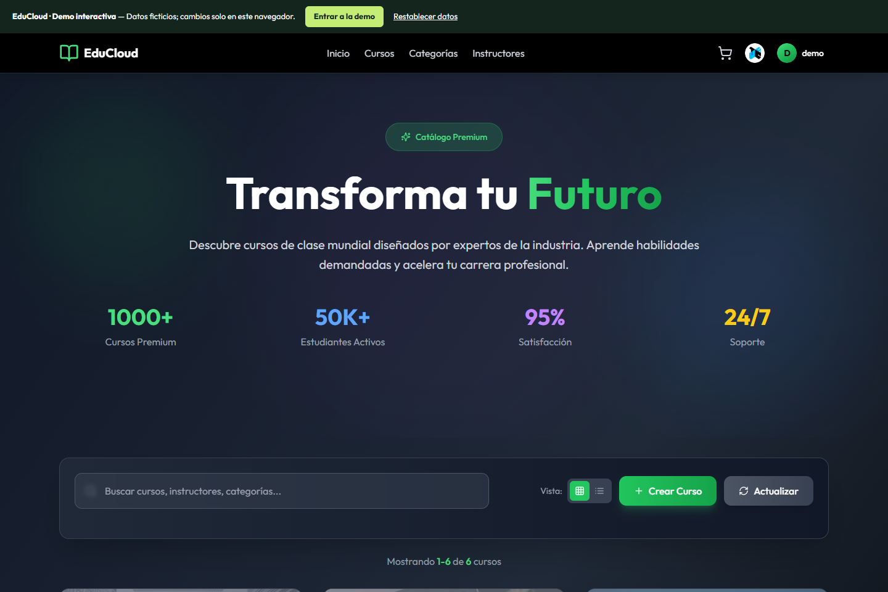

# EduCloud

Plataforma educativa con catálogo, búsqueda de cursos y compras simuladas.

**Edición de portafolio de Ronal Condor · proyecto académico colaborativo.**

**Mi participación:** desarrollo frontend con React y TypeScript, e integración con APIs para búsqueda, catálogo y gestión de cursos.

[Frontend original](https://github.com/ronaljcb/frontend-fi) · [Mi historial original](https://github.com/ronaljcb/frontend-fi/commits/main/?author=ronaljcb) · [Mi participación y arquitectura](docs/CONTRIBUTIONS.md)

[](https://educloud-blush.vercel.app) 



**[Abrir demo interactiva](https://educloud-blush.vercel.app)**

## Explorar

Búsqueda, creación y edición de cursos; carrito y compras simuladas; navegación por universidad.

La demo funciona sin las cuentas ni los servidores antiguos de AWS. Los datos son **ficticios**, las modificaciones se guardan en **localStorage del navegador** y pueden restablecerse desde la barra superior. No hay base de datos compartida, autenticación de producción, pagos reales ni recuperación de registros históricos. No introduzcas contraseñas reales o información personal.

Pulsa **Entrar a la demo**. Acceso manual opcional: usuario `demo`, contraseña `Demo123!`, universidad `UTEC`.

## Tecnología

React · TypeScript · Vite · Tailwind · arquitectura original en AWS.

## Ejecutar localmente

Requiere Node.js 22 y npm.

```sh
npm install
npm run dev
```

La aplicación se encuentra en la raíz del repositorio.

```sh
npm run build
```

## Despliegue

Importa este repositorio en Vercel y configura **Root Directory** como `.`. La configuración `vercel.json` de esa carpeta define el despliegue. El modo demo está habilitado de forma predeterminada.

## Arquitectura y recuperación

Consulta [la migración desde AWS](docs/MIGRATION.md), [la procedencia y revisiones originales](docs/PROVENANCE.md) y [las comprobaciones realizadas](docs/VERIFICATION.md).

Los créditos del equipo y la documentación académica original se conservan en los archivos originales. Esta edición organiza y adapta ese trabajo; no atribuye a una sola persona la autoría de todo el proyecto.
