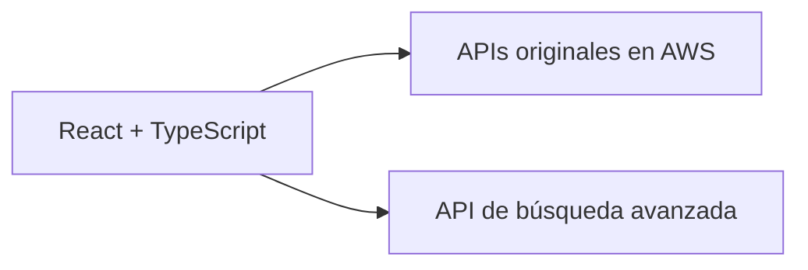

# Mi participación en EduCloud

EduCloud es una plataforma educativa desarrollada como proyecto académico colaborativo. Mi trabajo se centra en el frontend.

## Trabajo de Ronal Condor

- Desarrollo de interfaces con React, TypeScript y Tailwind CSS.
- Integración del frontend con APIs de catálogo y gestión de cursos.
- Desarrollo de la interfaz y el consumo de la API para búsqueda avanzada.

## Evidencia del historial original

- [Frontend original: ronaljcb/frontend-fi](https://github.com/ronaljcb/frontend-fi).
- [Historial vinculado a ronaljcb](https://github.com/ronaljcb/frontend-fi/commits/main/?author=ronaljcb).
- [Commit f68d529: búsqueda avanzada y actualización del frontend](https://github.com/ronaljcb/frontend-fi/commit/f68d529d3c31fc7752e7bb320aaad525ff571e87).

El historial disponible no documenta cada etapa de desarrollo por separado. Los enlaces muestran las contribuciones que pueden verificarse en esa fuente, sin reconstruir fechas o commits que no existen.

## Arquitectura e integración

El código del backend no se encontró entre las fuentes proporcionadas. Este repositorio no lo presenta como una implementación propia recuperada. La [demo de portafolio](https://educloud-blush.vercel.app) usa un adaptador local con datos ficticios, gestión de cursos, carrito y compras simuladas, sin pagos reales.

Consulta también [la migración](MIGRATION.md), [la procedencia](PROVENANCE.md) y [la verificación](VERIFICATION.md).
